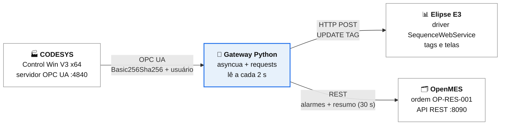

<div align="center">

# 🏭 API Grupo B

### Integração **CODESYS → Elipse E3 + OpenMES** por um gateway Python

Monitoramento de um reservatório simulado (nível, temperatura, vazão e bomba), com
dados no supervisório e alarmes no sistema de manufatura.


[](#-notion)

[Visão geral](#-visão-geral) •
[Início rápido](#-início-rápido) •
[Configuração](#-configuração) •
[Scripts](#-scripts) •
[Banco de alarmes](#-banco-de-dados-dos-alarmes-do-e3) •
[Problemas comuns](#-problemas-comuns) •
[Segurança](#-segurança) •
[Notion](#-notion)

</div>

---

## 📌 Visão geral

Um CLP simulado no **CODESYS** controla o nível de um reservatório. Um **gateway em Python** lê as
variáveis por **OPC UA** a cada 2 segundos e as entrega a dois destinos:

- **Elipse E3**: recebe os valores por HTTP (driver *SequenceWebService*) e os mostra em tela.
- **OpenMES**: recebe, pela **API REST**, os **alarmes de nível** (como problemas da ordem) e um
  **resumo dos valores** gravado na ordem de produção a cada 30 s.



### Variáveis monitoradas

| Variável no CODESYS | Nome no E3 (`Entity`) | Tipo | Unidade | Comportamento na simulação |
| --- | --- | --- | --- | --- |
| `GVL.rNivel` | `Nivel` | REAL | % | Começa em 50; a bomba liga com ≤ 30% e desliga com ≥ 80% |
| `GVL.rTemperatura` | `Temperatura` | REAL | °C | Oscila entre cerca de 23 e 27 |
| `GVL.rVazao` | `Vazao` | REAL | L/min | 20 com a bomba ligada, 0 desligada |
| `GVL.xBombaLigada` | `BombaLigada` | BOOL | 0 ou 1 | Estado da bomba |

### ✨ O que o projeto faz

- 🔐 Conecta ao OPC UA do CODESYS com **segurança** (`Basic256Sha256`, `SignAndEncrypt`, certificado e usuário).
- 📡 Envia as quatro variáveis ao **E3** a cada ciclo, no formato do driver SequenceWebService.
- 🚨 Registra **alarmes de nível baixo e alto** no OpenMES, com histerese e **fila de reenvio**.
- 📝 Grava um **resumo dos valores** no campo `description` da ordem, a cada 30 s.
- 🗄️ Guarda o **histórico de alarmes do E3** num banco **MySQL** que sobe com Docker Compose (pasta [`banco/`](banco)).
- 🧪 Traz scripts de **diagnóstico e teste** para cada etapa, sem precisar do gateway completo.

---

## 🚀 Início rápido

### Pré-requisitos

| Item | Versão ou detalhe |
| --- | --- |
| CODESYS | V3.5 SP21 Patch 1, com o runtime **Control Win V3 x64** |
| Elipse E3 | Studio com o driver **SequenceWebService v1.0.4** instalado |
| OpenMES | Instância acessível por HTTP (neste projeto, `http://localhost:8090`) |
| Python | 3.x, com `asyncua` e `requests` |
| Docker | Opcional, só para o banco de alarmes do E3 (Docker Desktop ou Docker Engine) |

### Instalação

```powershell
git clone https://github.com/matheusjardim-a11y/API_grupoB.git
cd API_grupoB

python -m venv .venv
.venv\Scripts\activate

pip install -r requirements.txt
cd api_reservatorio
copy config.example.py config.py      # depois, edite o config.py
```

> 💡 A biblioteca `cryptography` já vem com a `asyncua`. O `paho-mqtt` só é necessário se você ligar o MQTT (desligado por padrão).

### Passo a passo

| # | Etapa | Comando ou ação |
| :-: | --- | --- |
| 1 | **CODESYS**: criar o projeto com o código de [`codigos_codesys.txt`](codigos_codesys.txt), ligar o suporte a OPC UA na *Configuração de símbolos* e colocar o CLP em **RUN** | CODESYS |
| 2 | Gerar o certificado do cliente | `python gerar_certificado.py` |
| 3 | Aprovar o certificado: *View → Tela de segurança → Dispositivos → Quarantined → Trusted Certificates* | CODESYS |
| 4 | Preencher `USUARIO` e `SENHA` no `config.py` | editor |
| 5 | Descobrir os NodeIds e colar no `VARIAVEIS` | `python listar_nos.py` |
| 6 | Testar a leitura do CLP | `python teste_leitura.py` |
| 7 | **E3**: configurar o driver e as quatro tags, e testar o envio | `python testar_e3.py` |
| 8 | **OpenMES**: validar a API, criar a ordem e descobrir o campo de texto | `python testar_openmes.py` e `python testar_campo_ordem.py` |
| 9 | Rodar o gateway | `python gateway_codesys_e3.py` |
| 10 | *(Opcional)* Subir o MySQL do Servidor de Alarmes do E3 | `cd banco` e `docker compose up -d` ([detalhes](#-banco-de-dados-dos-alarmes-do-e3)) |

### Exemplo de saída do gateway

```text
INFO Conectado ao CODESYS
INFO Nivel = 37.60
INFO Temperatura = 23.64
INFO Vazao = 20.00
INFO BombaLigada = 1
INFO Ordem do OpenMES atualizada: Nível 37.6 % | Temperatura 23.6 C | Vazão 20.0 L/min | Bomba ligada | atualizado em 10/11 20:17:51
```

---

## 🔧 Configuração

Todas as opções ficam no `config.py` (copiado do `config.example.py`).

| Opção | Exemplo | Função |
| --- | --- | --- |
| `OPC_URL` | `opc.tcp://127.0.0.1:4840` | Endereço do servidor OPC UA do CODESYS |
| `USUARIO` / `SENHA` | — | Usuário e senha do dispositivo CODESYS |
| `VARIAVEIS` | `{"Nivel": "ns=4;s=..."}` | Liga cada `Entity` ao seu NodeId |
| `E3_URL` | `http://localhost:5051/` | Endereço e porta do driver no E3 |
| `ENVIAR_AO_E3` | `True` | Liga o envio ao E3 |
| `ENVIAR_AO_OPENMES` | `True` | Liga o registro de alarmes no OpenMES |
| `ATUALIZAR_ORDEM_OPENMES` | `True` | Liga o resumo na ordem, a cada 30 s |
| `OPENMES_URL` | `http://localhost:8090` | Endereço da API do OpenMES |
| `OPENMES_TOKEN` | vazio | Token fixo; vazio faz o gateway usar o login |
| `OPENMES_WORK_ORDER_ID` | `4` | Id da ordem que recebe alarmes e resumo |
| `OPENMES_ISSUE_TYPE_ID` | `11` | Tipo de problema dos alarmes (*Other Issue*) |
| `OPENMES_CAMPO_ORDEM` | `description` | Campo da ordem que recebe o resumo |
| `MODO_TESTE` | `False` | `True` usa limites de 31% e 79% para forçar alarmes |
| `ENVIAR_AO_MQTT` | `False` | Publicação MQTT (opcional, desligada) |

### 🔌 Portas usadas

| Porta | Programa | Observação |
| :-: | --- | --- |
| 4840 | Servidor OPC UA do CODESYS | |
| 5051 | Driver SequenceWebService do E3 | A padrão do driver, 8080, é ocupada pelo ScadaBR no laboratório |
| 8090 | OpenMES | |
| 3307 | MySQL dos alarmes do E3 (Docker) | Evita conflito com outro MySQL na 3306; configurável no `.env` |

### 🚨 Regras dos alarmes

| Alarme | Dispara quando | Rearma quando |
| --- | --- | --- |
| Nível baixo | nível ≤ 25% (31% em `MODO_TESTE`) | nível ≥ 30% (36%) |
| Nível alto | nível ≥ 90% (79% em `MODO_TESTE`) | nível ≤ 85% (74%) |

Cada ocorrência gera **um** problema na ordem. Se o OpenMES estiver fora do ar, até 20 mensagens ficam
em fila e são reenviadas no ciclo seguinte; o envio ao E3 continua normalmente.

---

## 🗄️ Banco de dados dos alarmes do E3

O **Servidor de Alarmes** do E3 pode gravar o histórico num banco de dados. Para isso, o repositório traz um
**MySQL 8** pronto em Docker, na pasta [`banco/`](banco). Só o `docker-compose.yml` e o modelo `.env.example`
são versionados; os **dados** ficam num volume local do Docker e **não vão ao GitHub**.

### Subir o banco

```powershell
cd banco
copy .env.example .env      # edite o .env e troque as duas senhas
docker compose up -d
docker compose ps           # deve aparecer "healthy"
```

### Configurar no E3 Studio

| Passo | Configuração |
| :-: | --- |
| 1 | Inserir um objeto **Database** com `SourceType = 4 - stMySQL` |
| 2 | **Server** `localhost` · **Port** `3307` · **Database** `alarmes_e3` · **User** `e3_alarmes` · **Password** a do `.env` |
| 3 | Clicar em **Test Connection** (nunca use o usuário `root`) |
| 4 | No **Alarm Server**, marcar **Store alarms on a database** e escolher o Database Server e o nome da tabela |
| 5 | Clicar em **Create Table**: o próprio E3 cria as tabelas |

Para conferir se os alarmes foram gravados:

```powershell
docker exec -it e3-alarmes-mysql mysql -ue3_alarmes -p alarmes_e3 -e "SHOW TABLES;"
```

> ⚠️ O MySQL 8.0.11 ou superior é exigido pelo E3. Segundo a base de conhecimento da Elipse, a conexão pode precisar
> do *Visual C++ 2019 Redistributable (x86)*. Para levar os dados a outro computador, gere um `mysqldump` e envie
> por fora do repositório.

---

## 📂 Estrutura do repositório

```text
API_grupoB/
├── 📄 README.md
├── 📄 .gitignore                 # bloqueia config.py, chaves, .env e arquivos locais do CODESYS
├── 📄 requirements.txt           # dependências do Python
├── 📄 .env.example               # modelo de variáveis de ambiente (sem senhas)
├── 🏭 codesys/                   # projeto CODESYS do reservatório
├── 🗂️ Tanque/                    # (descrever o conteúdo)
├── 🗄️ banco_dados/                     # MySQL dos alarmes do E3
│   ├── docker-compose.yml
│   ├── .env.example              # modelo; o .env real não é versionado
│   └── .gitignore
└── 🐍 api_reservatorio/          # gateway e scripts de teste
    ├── gateway_codesys_e3.py     # gateway: lê o CODESYS e envia ao E3 e ao OpenMES
    ├── config.example.py         # modelo do config.py (sem credenciais)
    ├── openmes_cliente.py        # cliente da API REST do OpenMES
    ├── mqtt_publicador.py        # publicação MQTT (opcional, desligada)
    ├── gerar_certificado.py      # certificado do cliente OPC UA
    ├── descobrir.py              # servidores e endpoints do OPC UA
    ├── listar_nos.py             # NodeIds das variáveis
    ├── teste_leitura.py          # leitura do CLP, sem enviar nada
    ├── testar_e3.py              # envio de valores fixos ao driver do E3
    ├── diagnostico_e3.py         # testa formatos de valor no E3
    ├── testar_openmes.py         # saúde, token e listagens do OpenMES
    ├── testar_campo_ordem.py     # descobre o campo de texto da ordem
    └── criar_produto.py          # cadastra um produto (módulo ERP do OpenMES)
```

> Os scripts da seção seguinte ficam em `api_reservatorio/`; rode os comandos a partir dessa pasta.

---

## 🧰 Scripts

| Script | Para que serve |
| --- | --- |
| `gateway_codesys_e3.py` | **Programa principal.** Lê o CODESYS e envia ao E3 e ao OpenMES |
| `gerar_certificado.py` | Cria `cliente_cert.der` e `cliente_key.pem` (uma vez) |
| `descobrir.py` | Mostra os endpoints de segurança e de usuário do servidor OPC UA |
| `listar_nos.py` | Imprime o NodeId das quatro variáveis |
| `teste_leitura.py` | Lê cinco vezes as variáveis, sem enviar nada |
| `testar_e3.py` | Envia valores fixos ao driver do E3 (resposta esperada: `Err` 0) |
| `diagnostico_e3.py` | Envia o mesmo valor em cinco formatos, para achar problemas de formato |
| `testar_openmes.py` | Valida API, token, linhas, ordens e tipos de problema; com `CRIAR_ISSUE = True` cria um problema |
| `testar_campo_ordem.py` | Descobre qual campo da ordem aceita texto e restaura o valor original |
| `criar_produto.py` | Cadastra um produto pela rota do módulo ERP (ainda não executado contra a instância) |

---

## 🐞 Problemas comuns

<details>
<summary><b>OPC UA: <code>BadServiceUnsupported</code>, <code>BadSecurityChecksFailed</code> ou <code>BadCertificateUseNotAllowed</code></b></summary>

- `BadServiceUnsupported`: o servidor só aceita conexão segura e usuário e senha. Use `criar_cliente()` do `config.py`.
- `BadSecurityChecksFailed`: o certificado está em quarentena. Mova-o para *Trusted Certificates* na Tela de segurança do CODESYS.
- `BadCertificateUseNotAllowed`: gere o certificado de novo com `gerar_certificado.py` (`MODO_CA = True`) e aprove-o outra vez.
- `BadUserAccessDenied`: `USUARIO` e `SENHA` do `config.py` ainda estão com os valores de exemplo.

</details>

<details>
<summary><b>E3: <code>Err</code> 0, mas a tela mostra <code>???</code> ou não muda</b></summary>

O `Err` 0 só confirma que o driver recebeu a requisição. Confira:

- O **Item** da tag é idêntico ao `Entity` (maiúsculas e minúsculas).
- A propriedade **`AdviseType`** das tags está em `0 - AlwaysInAdvise`.
- O projeto foi **salvo** e a aplicação foi **parada e iniciada de novo**.
- O Display da tela está ligado à tag do driver, e não a outra tag do projeto.

</details>

<details>
<summary><b>E3: a resposta é a página do Apache Tomcat, ou a conexão é recusada</b></summary>

- Página do Tomcat com HTTP 200: a porta é de outro programa (o ScadaBR usa a 8080). Troque a porta do driver e a `E3_URL`.
- `WinError 10061`: nada escuta na porta. Execute a aplicação do E3 e confira com `netstat -ano -p tcp | findstr :5051`.
- Tempo esgotado depois de reiniciar o computador: use `localhost` (mesmo computador) ou o IP da rede real.

</details>

<details>
<summary><b>MySQL dos alarmes: o E3 não conecta ou o contêiner não sobe</b></summary>

- `docker compose up` reclama de variável: o `.env` não existe ou está sem `MYSQL_ROOT_PASSWORD` e `MYSQL_PASSWORD`.
- **Test Connection** falha: confira `Server` `localhost`, `Port` `3307` e o usuário `e3_alarmes` (não o `root`). Se persistir, instale o *Visual C++ 2019 Redistributable (x86)*.
- Erro de plugin de autenticação: descomente a linha `mysql_native_password` no `docker-compose.yml` e rode `docker compose up -d --force-recreate`. Se o erro continuar, `docker compose down -v` recria o banco do zero (**apaga os dados**).
- `docker` não funciona no computador do laboratório: o Docker pode exigir permissão de administrador; nesse caso, instale o MySQL 8 direto no Windows.

</details>

<details>
<summary><b>OpenMES: <code>422</code>, conexão recusada ou resposta sem JSON</b></summary>

- `422` ao criar a ordem: esta versão pede `planned_qty`, e não `quantity`.
- Conexão recusada (`10061`): o OpenMES não está rodando; suba-o e confira `/api/health`.
- Login com 200 e sem JSON: a URL ou a porta estão erradas. O `testar_openmes.py` mostra a URL final e o `Content-Type`.

</details>

---

## 🔒 Segurança

> ⚠️ **Nunca envie ao GitHub** o `config.py` (usuário, senha, token) nem os arquivos do certificado
> (`cliente_key.pem` é uma chave privada). Use sempre o `config.example.py` como modelo.

Arquivo `.gitignore` sugerido:

```gitignore
# Credenciais e certificados
config.py
.env
cliente_key.pem
cliente_cert.der

# Python
__pycache__/
.venv/

# CODESYS (arquivos locais ou gerados; versionar só o .project)
*.~u
*.precompilecache
*.opt
*.bak
*.compileinfo

# Dumps do banco
*.sql
*.sql.gz
*.dump
```

Se o `config.py`, o `.env` ou a `cliente_key.pem` já tiverem sido enviados em algum commit, **troque** as senhas, o
token e o certificado: remover o arquivo depois não apaga o histórico do repositório. No caso da chave do certificado,
gere um novo par com `gerar_certificado.py`, aprove o novo certificado no CODESYS e remova o antigo dos *Trusted Certificates*.

---

## 📓 Notion

> 🔗 **Página do projeto no Notion:** [https://app.notion.com/p/API-Reservat-rio-414adc158b2c80bd8470e1e13e3d709b?source=copy_link](https://app.notion.com/p/API-Reservat-rio-414adc158b2c80bd8470e1e13e3d709b?source=copy_link)

---

## 🚧 Limitações

- O OpenMES mostra só o **último valor**, sem histórico nem gráfico. Para telemetria contínua seria preciso o **MQTT** com um broker (o código existe, mas está desligado).
- A comunicação entre o gateway e o E3 usa **HTTP simples**, sem criptografia, em ciclos de 2 s: serve ao trabalho acadêmico, não a um controle em tempo real.
- Sem licença, o runtime **Control Win** roda em modo de demonstração por cerca de duas horas e depois exige reinício manual.
- O banco dos alarmes do E3 depende de **Docker** (ou de um MySQL 8 instalado) no computador do E3, e a conexão do E3 com o MySQL ainda precisa ser validada no laboratório.
- A instância do OpenMES do grupo é **mais antiga** que a documentação publicada; nomes de campos podem divergir.

## 👥 Equipe

Projeto em grupo (**Grupo B**), SENAI.

- Ana Clara Rodrigues Abreu

- Augusto Sternadt Dziedicz

- Emanuel Coelho Lehnert

- Felipe Krueger

- Gabriel Baptista Martins

- Gustavo Engel

- Júlia Ribeiro Vansuita

- Luíza da Silva

- Matheus Scherer Jardim

- Rafael Fenilli Matosso
